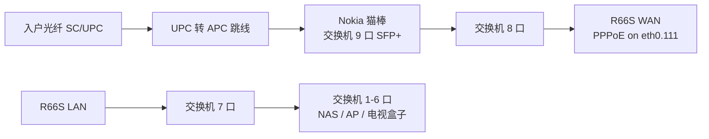

# 千兆联通换 2.5G 猫棒实录：从注册失败到测速 1235M

> 无锡联通千兆宽带，用 Nokia 2.5G GPON 猫棒替换运营商光猫。最终结果：**猫棒注册成功（状态 5），R66S 直接拨号，测速下行 1235 Mbps、上行 61 Mbps，延迟 4 ms**。本文按实际踩坑顺序整理，敏感参数均已打码。

---

## 📑 目录

- [先说结论：值不值得换](#先说结论值不值得换)
- [我的拓扑](#我的拓扑)
- [准备工作：从光猫抄哪些参数](#准备工作从光猫抄哪些参数)
- [配置猫棒：伪装成原光猫](#配置猫棒伪装成原光猫)
- [配置交换机：把 WAN 隔离出来](#配置交换机把-wan-隔离出来)
- [配置 R66S：为什么要在 eth0.111 上拨号](#配置-r66s为什么要在-eth0111-上拨号)
- [踩坑：卡在注册状态 3](#踩坑卡在注册状态-3)
- [测速结果](#测速结果)
- [顺手做了 NAS 链路聚合](#顺手做了-nas-链路聚合)
- [回滚方案](#回滚方案)
- [常见问题](#常见问题)

---

## 先说结论：值不值得换

| 项目 | 原光猫（千兆口） | 2.5G 猫棒 |
|------|------|------|
| 下行测速 | 约 940 Mbps | **1235 Mbps** |
| 上行测速 | 约 60 Mbps | 61 Mbps（不变） |
| 设备数量 | 光猫 + 路由 | 猫棒插交换机，少一个盒子 |
| 折腾成本 | 0（运营商提供） | 猫棒 49 元 + SC/APC 转接头；参数、VLAN、光功率都要搞 |

运营商千兆套餐的限速模板一般留有约 20% 余量，但光猫千兆网口把你卡在 940 左右。换成 2.5G 链路后，余量就能跑出来。**上行不会变**，日常网页、视频也感知不到，主要是网盘、Steam 这类大文件下载更快。

前提：**整条链路都要 2.5G**（猫棒 → 交换机 → 路由 → 测速设备）。我一开始用笔记本测只有 1022M，就是笔记本千兆网口顶到头了。

---

## 我的拓扑



- **猫棒**：Nokia 2.5G GPON SFP（国内改版固件，管理页 `192.168.1.10`）
- **交换机**：水星 SE109 Pro（8×2.5G 电口 + 1×10G SFP+，支持 VLAN）
- **路由**：R66S，iStoreOS（OpenWrt）
- **宽带**：无锡联通千兆，GPON，LOID + SN 认证

---

## 准备工作：从光猫抄哪些参数

替换前，在原光猫（我的是中兴 F657GV9）上记下这些信息：

| 参数 | 从哪里看 | 示例（已打码） |
|------|------|------|
| GPON SN | 光猫背面标签 / 状态页 | `ZTEG********` |
| LOID | 状态页，或打 10010 问装维 | `0510********01` |
| 设备 MAC | 背面标签 | `64:75:20:**:**:**` |
| 厂商 / 型号 / 版本 | 设备信息页 | `ZTEG` / `F657GV9` / `V9.0` |
| PPPoE 账号密码 | 装机单 / 10010 | `0510********` |
| 上网 VLAN | 光猫 WAN 连接配置 | **111**（无锡联通） |
| 接收光功率 | PON 状态页 | 我家约 -23 dBm |

> ⚠️ 我只在光猫上**读取**信息，没有破解超级密码、开 telnet。运营商装维能给到 LOID 和拨号信息时，直接问是最稳的。

---

## 配置猫棒：伪装成原光猫

猫棒先插在交换机 9 口，**不接光纤**。电脑设置同网段静态 IP（例如 `192.168.1.100`）后访问 `http://192.168.1.10`。

需要改的项：

1. **GPON SN**：填原光猫 SN
2. **LOID**：填原光猫 LOID，密码留空（江苏联通一般没有）
3. **Host MAC**：填原光猫 MAC
4. **厂商标识**：Vendor ID `ZTEG`、Equipment ID `F657GV9`、Version `V9.0`

踩坑：第一次改厂商信息后刷新又变回了 `HWTC`。需要同时打开「**MIB 自定义**」开关（`mib_customized=1`）再提交，才能真正保存。

---

## 配置交换机：把 WAN 隔离出来

猫棒出来的是**运营商侧的流量**，绝不能和家里的局域网混在一起。SE109 Pro 用**端口 VLAN**做隔离就够了：

| VLAN | 成员端口 | 用途 |
|------|------|------|
| VLAN 1 | 1–7 | 家庭局域网（R66S LAN 接 7 口） |
| VLAN 2 | 8–9 | WAN：9 口猫棒，8 口接 R66S WAN |

配好记得点「**配置保存**」，否则交换机重启后就没了。

> 端口 VLAN 只负责隔离，不会改动数据包里的 VLAN 标签，所以联通的 VLAN 111 会原样送到 R66S。

---

## 配置 R66S：为什么要在 eth0.111 上拨号

原来光猫在帮我们做一件事：**剥掉 VLAN 111 标签**，把普通流量交给路由器，所以路由器直接在 `eth0` 上拨号。

换成猫棒以后，标签原样透传。联通 OLT 只响应带 VLAN 111 的 PPPoE 请求，所以 R66S 的 WAN 必须改成 `eth0.111`：

```bash
# 先备份
cp /etc/config/network /root/network.bak-pre-gpon

# 改 WAN 物理设备
uci set network.wan.device='eth0.111'
uci commit network
ifup wan
```

或者在 LuCI 里打开「网络 → 接口 → WAN」，把设备改成自定义的 `eth0.111`，协议仍然用 PPPoE，账号密码不变。

成功后：

```bash
ifstatus wan | grep -E '"up"|"address"'
# "up": true
# "address": "112.87.xxx.xxx"
```

IPv6 也能自动拿到。

---

## 踩坑：卡在注册状态 3

第一次切换失败了，猫棒状态页显示：

```
注册状态 / 信号状态：3 / true
接收光功率：-28.72 dBm
```

GPON 注册状态大致含义：

| 状态 | 含义 |
|------|------|
| 1 | 无光 / 初始化 |
| 2–3 | 参数或光路有问题，没走完认证 |
| 4 | OLT 拒绝 |
| **5** | **注册成功** |

我的排查顺序：

1. **光功率**：Nokia 猫棒的接收灵敏度大约是 **-27.5 dBm**，-28.7 已经低于下限。原光猫同一根纤是 -23 dBm 左右，说明问题出在接头。
2. **APC / UPC 不匹配**（最关键）：Nokia 猫棒是 **SC/APC（绿色、斜面）**，入户纤通常是 **SC/UPC（蓝色、平面）**。直接硬插会多损耗好几个 dB。必须用 **SC/UPC 转 SC/APC 跳线 + 法兰**。
3. **清洁端面**：用酒精棉 / 擦纤笔擦完后升到 -26.85 dBm，还是卡在 3。
4. **原光猫要彻底断电**：同一个 SN 同时在线会冲突，换下的光猫要拔电。
5. **OLT 冷却**：频繁切换以后，有的 OLT 会锁一段时间，等 10–15 分钟再试。
6. **SN / LOID 再核对一遍**：一个字符错了就是状态 3。

把 APC 转接线接对、原光猫断电后再手动切换，**状态直接到 5**，PPPoE 秒拨上。

> 💡 我在 R66S 上写了个带自动回滚的切换脚本：切换后 5 分钟内 ping 不通外网就自动改回 `eth0`。拔了光纤就没网，没有这个兜底会很被动。

```bash
#!/bin/sh
# /root/gpon-auto.sh
/root/gpon-cutover.sh            # 改成 eth0.111 并 ifup
for i in $(seq 1 30); do
  sleep 10
  if ifstatus wan | grep -q '"up": true' && ping -c1 -W2 223.5.5.5 >/dev/null; then
    echo OK > /root/gpon-result; exit 0
  fi
done
echo ROLLBACK > /root/gpon-result
/root/gpon-rollback.sh           # 还原备份并 reload
```

---

## 测速结果


| 测试方式 | 下行 | 上行 | 说明 |
|------|------|------|------|
| 笔记本（千兆网口） | 1022 Mbps | — | 网卡瓶颈 |
| 2.5G 设备，无锡联通节点 | **1235 Mbps** | 61 Mbps | 延迟 4 ms，抖动 1.1 ms |

网友反馈的江苏联通千兆换 2.5G 后多数在 **1150–1300 Mbps**，和我的结果一致。

另外两个注意点：
- **光功率影响稳定性，不直接决定速度**。光够了就是满速协商；光不够会误码、掉线、注册不上。
- **猫棒很热**：我这根 CPU 51–54℃、激光器 41–44℃，属于正常范围。夏天建议加散热片。

---

## 顺手做了 NAS 链路聚合

QNAP TS-264C 的两个 2.5G 口接交换机 1、2 口：

- NAS：`bond0`，模式 **Balance-XOR**（静态）
- 交换机：「二层交换 → 汇聚管理」，汇聚组 1 = 端口 1、2

SE109 Pro **只支持静态汇聚，不支持 LACP（802.3ad）**，所以 NAS 不能选 802.3ad。各模式简单对比：

| 模式 | 带宽叠加 | 冗余 | 交换机要求 |
|------|------|------|------|
| Active-Backup | ✗ | ✓ | 无 |
| Balance-XOR | 多连接 ✓ | ✓ | 静态汇聚 |
| 802.3ad (LACP) | 多连接 ✓ | ✓ | 需支持 LACP |
| Balance-rr | ✓（易乱序） | ✓ | 静态汇聚 |

单个连接最多还是一根线的 2.5G，多台设备同时访问 NAS 才会叠加。拔掉一根线也不会断网。

---

## 回滚方案

万一哪天猫棒出问题：

1. R66S WAN 设备改回 `eth0`（或执行 `cp /root/network.bak-pre-gpon /etc/config/network && /etc/init.d/network reload`）
2. 光纤插回原光猫，光猫 LAN 口接 R66S WAN
3. 光猫开机，等注册完成后 R66S 重新拨号

**原光猫别扔**，报修时装维也可能需要它。

---

## 常见问题

**Q：猫棒能突破千兆套餐吗？**
不能“白嫖”带宽。只是把套餐本来就有的约 20% 余量跑出来。

**Q：联通网络电视盒子还能用吗？**
联通的互联网电视盒子（OTT）走普通宽带，接在局域网里就能用。只有原来插在光猫专用 iTV 口、走独立 VLAN 的才需要另外配置。

**Q：一定要 SFP+ 交换机吗？**
猫棒是 SFP 接口，要插在带 SFP/SFP+ 口、**支持 2.5G 速率**的交换机或路由器上。只支持 1G 的口就跑不出千兆以上。

**Q：要不要找光猫超级密码 / 开 telnet？**
不建议。SN、LOID、MAC、VLAN 这些参数，在光猫普通状态页上读、问装维要，基本都能拿到。

---

*设备清单：Nokia 2.5G GPON SFP 猫棒、SC/UPC-SC/APC 跳线、水星 SE109 Pro、R66S（iStoreOS 25.12）、QNAP TS-264C。*
